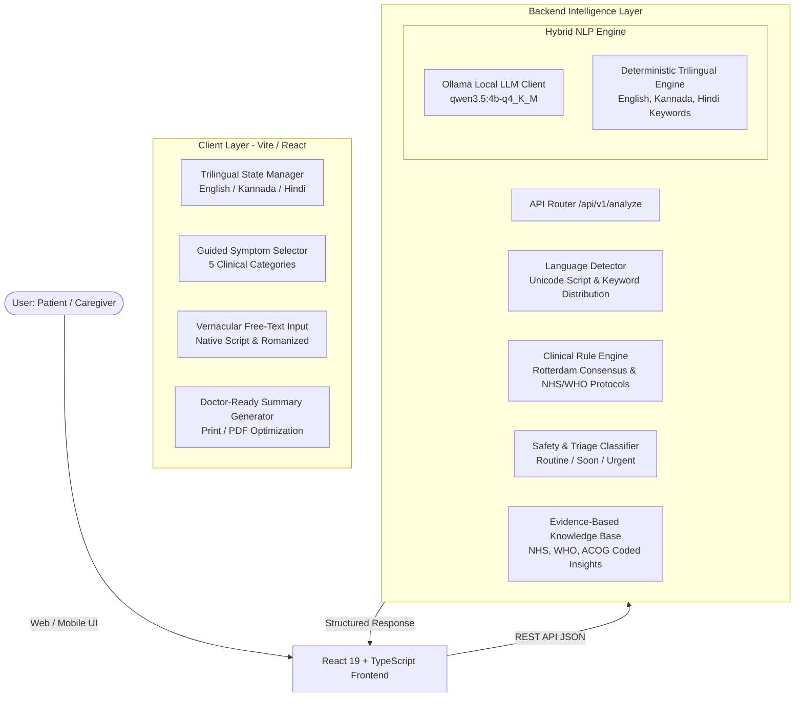

# SakhiCare — Technical Architecture

SakhiCare is a compassionate, privacy-first, multilingual health information and care navigation tool designed for women's reproductive health, with specialized guidance for Polycystic Ovary Syndrome (PCOS).

---

## 1. System Overview

SakhiCare uses a modern decoupled architecture designed for local execution, low latency, and zero cloud dependency.

---

## 2. Key Components

### 2.1 Frontend (`/frontend`)
- **Framework:** React 19 with TypeScript, powered by Vite 8.
- **Styling:** Custom CSS Design System tailored for compassionate health interfaces:
  - Color Palette: Deep Plum (`#4A2463`), Soft Cream (`#FDF8F0`), Lavender (`#C4B1D4`), Healing Teal (`#4A9B8E`), Warm Amber (`#D4943A`).
  - Typography: Google Outfit (headings) + Inter (body).
  - Responsive layout: Mobile-first viewport constrained to 480px max-width container, matching modern mHealth applications.
- **Key Screens:**
  1. `WelcomeScreen.tsx` — Multilingual language selection, clear non-diagnostic disclosure, privacy assurance.
  2. `CheckInScreen.tsx` — Dual-mode input (guided chips across 5 physiological categories + vernacular free-text textarea + timeline duration selector).
  3. `AnalyzingScreen.tsx` — Empathetic animated loading states with educational micro-tips.
  4. `ConfirmScreen.tsx` — Human-in-the-loop verification where users review, edit, and confirm recognized symptoms before proceeding.
  5. `ResultsScreen.tsx` — Evidence-based PCOS pattern explanation, safety guidance card, interactive tabs (Insights, Care Navigation, Doctor Questions).
  6. `ReportScreen.tsx` — Doctor-Ready printable clinical report with structured symptom timeline, suggested diagnostics, and ethical disclaimers.

### 2.2 Backend (`/backend`)
- **Framework:** FastAPI with Uvicorn.
- **Validation:** Pydantic v2 data models with string sanitization and length bounds.
- **Hybrid NLP Extraction Pipeline:**
  - **Primary:** Local quantized LLM via Ollama (`qwen3.5:4b-q4_K_M`). Prompts enforce strict JSON output schema without diagnostic assertions.
  - **Instant Fallback:** High-performance deterministic keyword and n-gram matcher. Works instantly with 0 external dependencies or GPU requirements.
  - **Multilingual Support:** Native Kannada (`kn`), native Hindi (`hi`), English (`en`), and Romanized Indian vernaculars (Hinglish, Kanglish).

---

## 3. Data Flow & Lifecyle

1. **User Input:** User selects guided symptoms or inputs free-text in their preferred language/script (e.g., Kannada: `"ನನಗೆ ಮೂರು ತಿಂಗಳಿಂದ ಮುಟ್ಟು ಸರಿಯಾಗಿ ಬರುತ್ತಿಲ್ಲ"`).
2. **Sanitization & Language Detection:** Input is sanitized of control characters. Unicode character distribution detects native Kannada, Hindi, or Latin script.
3. **Extraction & Normalization:**
   - The NLP engine identifies mentioned symptoms, extracts duration, and normalizes regional expressions to standard medical descriptors (e.g., "ಮುಟ್ಟು ಬರುತ್ತಿಲ್ಲ" → `missed_periods`).
4. **Human-in-the-Loop Confirmation:** Extracted symptoms are presented to the user for explicit confirmation or correction.
5. **Clinical Navigation & Triage:**
   - Safety checks evaluate red flags (e.g., acute pelvic pain, haemorrhage) against NHS urgent protocols.
   - PCOS pattern recognition assesses symptom co-occurrence against the Rotterdam consensus framework.
6. **Report Generation:** Generates a clean, non-diagnostic appointment summary for the patient to present to a clinician.

---

## 4. Privacy & Ethical Guardrails

- **Zero Data Retention:** No health data is stored in databases or transmitted to third-party tracking services. All processing happens ephemerally in RAM.
- **Strictly Non-Diagnostic:** Every response and report reinforces that SakhiCare is an educational information guide, not a medical practitioner.
- **Hallucination Prevention:** The deterministic fallback engine operates entirely on curated medical taxonomies; LLM prompts strictly constrain outputs to predefined symptom IDs.
